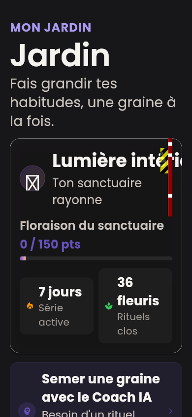
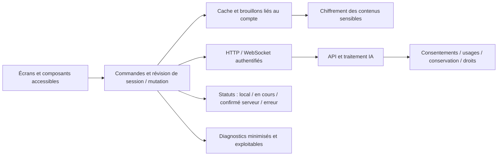

# Audit approfondi du frontend Elyrii — préparation 2027

**Date : 10 octobre 2026. Branche : `frontend`. Commit audité : `4b90d68ff8c09fd9e357f40ed78e5422bb80aa18`.**

## 1. Avis de mise en production

**Elyrii dispose d’un socle Flutter sérieux, mais je ne recommande pas encore un lancement grand public dans son état actuel.** Les principaux obstacles concernent la fiabilité du journal, le parcours de compte en production, la protection effective des données sensibles, la sécurité du parcours IA et l’accessibilité. Ils ne nécessitent pas une réécriture du frontend.

Les contrôles techniques habituels sont bons : analyse statique propre, formatage propre et **245 tests existants réussis**. Ils ne suffisent pas à garantir les parcours réels : des tests supplémentaires reproduisent des anomalies de synchronisation et la matrice d’affichage détecte des débordements à 200 % de taille de texte.

Pour un lancement Android/iOS en France/UE, les priorités sont :

1. Empêcher une lecture ancienne de masquer une note créée ou de faire réapparaître une note supprimée ; distinguer un succès serveur d’un échec de cache local.
2. Terminer la vérification d’adresse email, le renouvellement de session et la récupération de compte.
3. Remplacer les textes juridiques provisoires et rendre les engagements de confidentialité vérifiables.
4. Ajouter le signalement des réponses IA et renforcer le parcours d’aide en situation de détresse.
5. Corriger les formulaires accessibles, les contrastes et les écrans avec texte agrandi.
6. Valider des versions signées sur appareils physiques, avec mesures de performance et observations de production respectueuses de la vie privée.

**Aucune vulnérabilité P0 exploitable à distance n’a été démontrée dans cet audit.** Ce constat ne constitue pas une validation de tous les contrôles de sécurité : aucun pentest de l’infrastructure, du modèle IA ou des binaires de distribution n’a été réalisé.

## 2. Périmètre, hypothèses et méthode

### Périmètre effectivement audité

- Application `elyrii_app` : démarrage, navigation, connexion, inscription, profil/avatar, dashboard, journal, chatbot, coach, méditation, défis, mascotte 3D, bilan et paramètres.
- Architecture de dépendances, gestion des comptes, HTTP/WebSocket, persistance, chiffrement, cycles de vie, erreurs, design system, accessibilité et tests.
- Configuration Android/iOS, dépendances verrouillées et pipeline GitHub Actions.
- Contrats serveur nécessaires pour comprendre les parcours frontend, notamment authentification, vérification d’email, durée des jetons et paramètres. Ce travail n’est pas un audit complet du backend.
- Référentiels et politiques officiels disponibles à la date de l’audit, avec les échéances 2027 publiées.

La documentation existante [fixe un périmètre Android/iOS natif](../../mobile/frontend-audit-implementation.md). Le web ne fait donc pas partie du résultat de conformité ou de performance. Les conditions d’un éventuel lancement web figurent en annexe.

En l’absence de précision supplémentaire sur le lancement, **la France et l’UE servent de référence**, avec un public susceptible d’inclure des jeunes, conformément au positionnement du README. Les obligations dépendant de l’âge réel des utilisateurs, du modèle commercial ou d’une finalité médicale sont signalées comme conditionnelles.

### Niveaux de preuve

| Marqueur | Signification |
| --- | --- |
| **R — reproduit** | Comportement observé dans un test ciblé utilisant le code réel et des entrées contrôlées. |
| **S — source** | Constat établi dans les sources/configurations. Son impact en production dépend parfois du serveur réellement déployé. |
| **V — validation requise** | Risque ou contrôle qui demande un appareil, un binaire signé, des accès de production ou une qualification métier/juridique. |

Les priorités expriment l’impact sur un lancement public : **P1** à traiter avant lancement, **P2** à planifier pour la fiabilité et la compétitivité, **P3** amélioration conditionnelle. **P0** serait réservé à un incident majeur ou à une exploitation urgente démontrée ; aucun n’est attribué ici.

Les tailles de travail du [backlog](backlog.csv) sont des ordres de grandeur de réalisation : S, changement local ; M, plusieurs composants ; L, coordination frontend/backend/produit ou qualification externe. Elles ne promettent pas un calendrier ni une conformité juridique.

### Exécution et limites

Le dépôt initial était propre. La branche distante a été récupérée, une branche locale `frontend` a été créée avec suivi de `origin/frontend`, puis `git pull --ff-only origin frontend` a confirmé qu’elle était à jour. L’audit porte sur le commit indiqué ; aucun correctif applicatif, commit ou push n’a été effectué.

Le SDK du projet a été installé et utilisé : **Flutter 3.47.4 / Dart 3.13.3**, selon `.fvmrc`. L’exécution a utilisé un environnement Linux et des services de test. Les dépendances ont été résolues avec le lockfile imposé.

**Les builds Android/iOS, les tests sur appareils, les appels vers une production réelle et la validation des stores n’ont pas été exécutés.** L’environnement ne dispose ni du SDK Android ni de Xcode ; certains dépôts d’outillage natif sont inaccessibles par la politique réseau. Les jobs natifs présents dans GitHub Actions ont été lus, mais leur réussite récente n’a pas été vérifiée.

La matrice visuelle emploie les polices du projet, les thèmes réels et des providers de l’application, avec API de test et session de démonstration. Le stockage du journal est remplacé dans cette matrice pour isoler le rendu ; les reproductions de synchronisation emploient le vrai repository et le stockage SQLite de test. Les WebViews, permissions, plugins natifs et animations 3D réelles ne sont pas validés par ces captures. Les états affichés ne couvrent pas chaque modale, clavier, erreur ou interaction de toutes les pages.

## 3. Résultats mesurés

| Contrôle | Résultat | Portée |
| --- | --- | --- |
| `flutter pub get --enforce-lockfile` | Réussi | Dépendances verrouillées résolues avec le SDK attendu. |
| `flutter analyze --no-pub` | Aucune anomalie | Analyse statique, pas preuve de comportement ou de sécurité. |
| `dart format --output=none --set-exit-if-changed …` | 234 fichiers, 0 changement | `lib`, `test`, `tool`, `integration_test`, `test_driver`. |
| Suite existante, avec couverture | **245 tests réussis** | Tests unitaires et widgets existants ; pas les intégrations natives. |
| Couverture LCOV | **7 840 / 11 595 lignes instrumentées : 67,62 %**, 158 fichiers | La couverture ne décrit ni toutes les sources ni la qualité des assertions. |
| Tests supplémentaires d’audit | **10 reproductions confirmées** | Ils décrivent des défauts actuels ; leur réussite ne signifie pas que ces comportements sont acceptables. |
| Matrice visuelle | **56 observations**, **8 configurations avec erreur**, **11 débordements RenderFlex** | 14 pages × 4 configurations. 48 configurations sans erreur de layout enregistrée dans les états testés. |
| Dépendances | 57 entrées dans `pub outdated --json` | Retards de version ; ce nombre n’est pas un nombre de vulnérabilités. |

Les fichiers [metrics.json](evidence/metrics.json), [journal des tests](evidence/tests.log), [reproductions](evidence/probes.log), [matrice détaillée](evidence/layout.json) et [inventaire de versions](evidence/outdated.json) permettent de vérifier ces chiffres.

La couverture est inégale. Dans les lignes instrumentées, plusieurs parcours ont moins de 1 % de couverture : inscription, onboarding, édition de profil et paramètres. Les fonctions techniques disposent de tests utiles, mais des événements déterminants pour un utilisateur restent peu testés. Augmenter un pourcentage global en testant des getters ne résoudrait pas ce problème.

### Affichage à 200 %

| Page | 320 × 568, thème clair, texte 200 % | 390 × 844, thème sombre, texte 200 % |
| --- | --- | --- |
| Connexion | Débordements 136 et 118 px | 66 et 48 px |
| Inscription | 118 px | 48 px |
| Dashboard | 30 et 80 px | 10 px |
| Défis | 280 px | 210 px |

Les configurations 390 × 844 à 100 % et tablette paysage 1024 × 768 à 100 % n’ont pas produit d’erreur de layout enregistrée. Le rendu tablette du harness ne signifie pas que l’application autorise actuellement cette orientation sur iOS.

Exemple du défaut du jardin en thème sombre, texte 200 % :



## 4. Ce qui est déjà bien construit

Il est important de préserver ces acquis pendant les corrections :

- **Gestion des comptes et des réponses tardives.** La composition des dépendances invalide les requêtes et réinitialise les providers lors d’un changement de session. L’authentification protège les opérations concurrentes et les résultats d’un ancien compte. Les défauts ci-dessous concernent des commandes dans une même session, plutôt qu’une absence générale d’isolation.
- **Stockage sécurisé.** Les jetons utilisent le stockage sécurisé et n’ont pas de repli silencieux en préférences non chiffrées. Le chat et le journal disposent de stockage local chiffré AES-GCM, avec clé liée au compte, nonce et données authentifiées. Des tests couvrent migrations, brouillons, purge et écritures tardives.
- **Transport et distribution.** Les configurations de production exigent des endpoints HTTPS ; Android désactive les sauvegardes applicatives et le trafic en clair. Un build de distribution Android ne doit pas utiliser automatiquement la clé de debug.
- **Chat.** Authentification WebSocket native par en-tête, corrélation `requestId`/conversation, états d’envoi, délais de connexion et de réponse, reprise explicite, historique paginé, garde contre les réponses d’une conversation supprimée. Les contenus locaux sont distingués des contenus synchronisés dans les paramètres.
- **Méditation.** Mesure de durée avec `Stopwatch`, pause lors du passage en arrière-plan, reprise explicite et protection des enregistrements tardifs. Les contrôleurs ont un cycle de vie organisé.
- **Mascotte.** Adaptateur centralisé, accessoires validés, échappement des valeurs injectées en JavaScript, contrôle de visibilité et prise en compte de la réduction des animations. La dépendance native étudiée sert ses ressources sur l’interface loopback et embarque le JavaScript du viewer : cet audit n’a pas établi de chargement obligatoire depuis un CDN tiers.
- **Accessibilité commune.** Des composants ont des actions nommées, focus clavier et cibles tactiles confortables ; des adaptations de mouvement et de contraste existent. Leur adoption reste incomplète dans certains parcours.
- **CI.** SDK épinglé, lockfile imposé, formatage/analyse/tests/couverture, builds techniques Android et simulateur iOS, intégrations natives et documentation. Les permissions du workflow sont limitées en lecture.
- **Architecture.** Séparation par fonctionnalités, repositories testables et dépendances remplaçables. Flutter, Provider et GoRouter conviennent à cette application : une migration vers un autre framework n’apporterait pas à elle seule la qualité attendue.

## 5. Constats prioritaires

### F01 — Textes juridiques provisoires et consultation impossible avant inscription

**P1 · S · Produit/juridique + frontend.** [Paramètres, lignes 268–286](../../../elyrii_app/lib/features/settings/pages/settings_page.dart#L268) ; [case de conditions, ligne 339](../../../elyrii_app/lib/features/auth/presentation/pages/register_page.dart#L339).

La rubrique confidentialité explique ce que « la politique doit » contenir ; les conditions indiquent ce que « les conditions doivent » préciser. Ce sont des instructions de rédaction. Le texte coloré des conditions à l’inscription n’ouvre aucun document : le geste bascule la case d’acceptation. La politique n’est pas accessible dans le parcours non connecté observé.

**Impact :** impossibilité de prendre connaissance des engagements réels avant de transmettre des données ; risque RGPD et de refus de distribution. L’acceptation des CGU ne remplace pas une base légale ou un consentement spécifique.

**Correction attendue :** documents publiés, versionnés, lisibles sans compte et accessibles ; identité de l’éditeur, finalités, catégories, hébergement/destinataires, conservation, droits et contact. Associer la bonne version à l’acceptation si nécessaire. **Acceptation :** ouvrir chaque document avant inscription avec TalkBack/VoiceOver, en vérifier la version et tester les états indisponibles.

### F02 — Mode « confidentialité stricte » sans effet de protection démontré

**P1 · S · Frontend + backend + responsable des données.** [Bascule des paramètres, ligne 193](../../../elyrii_app/lib/features/settings/pages/settings_page.dart#L193) ; [validation serveur](../../../elyrii_server/modules/user/user.controller.ts#L17).

La bascule promet de limiter les usages des données et persiste `privacyMode: STRICT`. Dans les sources examinées, cette valeur est stockée/validée, sans consommateur démontré qui change les envois du chat, le cache sensible ou les usages IA. Une politique implémentée dans un service extérieur au dépôt reste possible, mais aucune preuve n’est disponible ici.

**Impact :** contrôle de confidentialité dont l’effet réel est indéterminé. **Correction attendue :** définir une liste vérifiable des traitements permis/interdits par mode, la propager aux services concernés et expliquer exactement l’effet à l’utilisateur. Retirer la promesse tant que le contrat n’est pas implémenté. **Acceptation :** comparer les flux et traitements en STANDARD/STRICT et prouver les exclusions côté serveur, pas seulement la persistance de la valeur.

### F03 — Humeurs et objectifs du dashboard dans un cache JSON non chiffré

**P1 · R · Frontend/sécurité.** [Écriture du cache, ligne 75](../../../elyrii_app/lib/features/dashboard/data/repositories/dashboard_repository.dart#L75).

La reproduction lit une humeur `anxious`, sa distribution et un objectif personnel dans la préférence `cache_dashboard_data_audit-user_30d`. Le cache est correctement lié au compte et limité à 24 heures, mais son contenu reste lisible dans les préférences. L’audit ne démontre pas une fuite distante ; le sandbox et le chiffrement du système restent des protections.

**Impact :** protection applicative incohérente pour des données susceptibles de révéler l’état psychologique. **Correction attendue :** classifier tous les caches, minimiser le contenu et chiffrer ce qui est sensible avec la clé du compte, ou éviter sa persistance. Prévoir migration, purge, TTL et gestion d’une clé indisponible. **Acceptation :** aucune humeur, note ou objectif sensible lisible dans les fichiers applicatifs inspectés ; tests entre comptes et après suppression.

Le [README](../../../README.md#L42) annonce aussi du chiffrement « end-to-end » et une conformité GDPR. Le chiffrement local et TLS n’établissent pas cette affirmation : le client transmet des contenus JSON lisibles au service conversationnel. Décrire les protections réellement présentes ; réserver une revendication E2E à un protocole et à un modèle de menace effectivement démontrés.

### F04 — Absence de signalement intégré des réponses IA

**P1 · S · Frontend + backend/modération.** [Bulle de message](../../../elyrii_app/lib/features/chatbot/presentation/widgets/chat_message_bubble.dart) ; [page de chat](../../../elyrii_app/lib/features/chatbot/presentation/pages/chatbot_page.dart).

Aucune action permettant de signaler une réponse IA au développeur n’a été trouvée. Le bouton d’urgence ne remplit pas cette fonction. **La politique Google Play sur les contenus générés par IA exige un signalement depuis l’application** pour les applications concernées [référence S04].

**Correction attendue :** action sur une réponse, motifs, confirmation, envoi sécurisé, statut et traitement effectif par l’équipe. Limiter les contenus transmis et informer l’utilisateur du contexte envoyé. Un simple « pouce vers le bas » sans transmission/traitement ne suffit pas. **Acceptation :** un utilisateur signale un message sans quitter l’app ; le signalement arrive à l’opérateur, avec un traitement des erreurs et une politique hors ligne explicite.

### F05 — Détection de détresse trop rudimentaire pour servir de garantie de sécurité

**P1 · R · Produit/sécurité IA + frontend/backend.** [Liste et recherche de mots, lignes 8–27](../../../elyrii_app/lib/features/chatbot/presentation/widgets/crisis_detection_banner.dart#L8).

Le texte « Je vais sauter à la corde » et « Je vais avaler mon petit déjeuner » déclenche l’alerte ; « Je veux en finir avec tout » ne la déclenche pas. Le mécanisme est une recherche de sous-chaînes, sans contexte ni normalisation étendue. Cette preuve concerne le déclencheur frontend ; elle n’évalue pas toutes les protections du modèle ou du serveur.

**Impact :** alertes inutiles et situations préoccupantes non reconnues par ce mécanisme. L’accès permanent à l’aide est un acquis à conserver. **Correction attendue :** politique de sécurité revue par des personnes compétentes, corpus de tests français incluant négation, ambiguïtés, accents, fautes et intentions indirectes ; aide disponible indépendamment de la détection ; ressources adaptées au pays. Éviter de présenter une heuristique ou le chatbot comme une évaluation clinique. **Acceptation :** scénarios de risque revus, faux positifs/négatifs documentés et parcours d’aide réellement utilisable sur appareil.

### F06 — Âge facultatif et mineurs non distingués dans les parcours sensibles

**P1 si accueil de mineurs · S/V · Produit/juridique + frontend/backend.** [Onboarding, ligne 119](../../../elyrii_app/lib/features/profile_setup/presentation/pages/profile_setup_page.dart#L119) ; [âge par défaut serveur, ligne 76](../../../elyrii_server/modules/auth/auth.controller.ts#L76).

L’inscription ne transmet pas d’âge, le serveur remplace une valeur manquante par 18 et l’onboarding propose un âge optionnel. Le frontend observé ne comporte pas de parcours parental ni de règles spécifiques d’accès au service IA/données sensibles.

**Correction attendue :** définir les âges réellement admis et les traitements autorisés ; représenter un âge inconnu comme inconnu ; appliquer une vérification proportionnée et un parcours parental lorsque la base légale et la réglementation le demandent. En France, le seuil de 15 ans relatif au consentement numérique s’applique dans le cadre concerné ; ce n’est pas une interdiction universelle de toute application pour les moins de 15 ans [S06]. **Acceptation :** scénarios âge inconnu/moins de 15 ans/15–17/adulte testés selon la politique retenue, sans collecte d’identité excessive.

### F07 — Activation email de production non terminée dans l’application

**P1 · S · Frontend + backend/email.** [Contrat serveur, lignes 20 et 83](../../../elyrii_server/modules/auth/auth.controller.ts#L20) ; [traitement inscription, ligne 91](../../../elyrii_app/lib/features/auth/presentation/pages/register_page.dart#L91).

En mode production, le serveur exige la vérification email, renvoie un succès sans access token et bloque une connexion non vérifiée par un 403. Le frontend affiche brièvement le message puis revient à la connexion. Aucun écran d’attente, renvoi d’email ou prise en charge native d’un lien de vérification n’a été trouvé. Les endpoints de vérification existent ; cela ne termine pas le parcours.

**Impact :** un parcours public peut aboutir à un compte créé mais inutilisable depuis l’app. Un éventuel parcours externe déployé n’a pas été vérifié. **Correction attendue :** contrat d’état explicite `verificationRequired`, écran persistant, canal email réel, renvoi limité, lien sécurisé, expiration et connexion après validation. **Acceptation :** E2E sur un serveur de staging configuré comme la production, depuis une installation neuve jusqu’à une session vérifiée ; mauvais lien, lien expiré et renvoi compris.

### F08 — Aucun renouvellement natif face à un access token de 15 minutes

**P1 · S · Frontend + backend/auth.** [Durée serveur](../../../elyrii_server/utils/jwt.utils.ts#L12) ; [cookie de refresh](../../../elyrii_server/modules/auth/auth.controller.ts#L40) ; [client HTTP](../../../elyrii_app/lib/core/network/api_client.dart#L37).

Le serveur émet un access token de 15 minutes et un refresh token en cookie HttpOnly. Le client natif utilise `http.Client()` sans gestionnaire de cookies identifié, ne consomme pas `/auth/refresh` et ne met pas en œuvre le renouvellement. Les méthodes de stockage du refresh token existent, sans parcours applicatif qui les utilise. Un 401 déclenche l’invalidation de session.

**Impact :** risque de reconnexions fréquentes et de commandes interrompues au-delà de 15 minutes, selon le serveur correspondant à ces sources. **Correction attendue :** choisir un contrat mobile cohérent : gestion sécurisée des cookies ou mécanisme de renouvellement natif avec rotation/révocation. Sérialiser les refresh concurrents et préserver le compte/contexte d’origine. Ne pas rejouer aveuglément un POST dont le résultat est incertain. **Acceptation :** session utilisée au-delà de 15 minutes, refresh concurrent, jeton révoqué, changement de compte pendant le refresh et retour d’arrière-plan testés.

### F09 — Une ancienne lecture du journal annule visuellement une mutation réussie

**P1 · R · Frontend.** [Chargement du provider, lignes 104–129](../../../elyrii_app/lib/features/journal/presentation/providers/journal_provider.dart#L104) ; [retour du repository, ligne 50](../../../elyrii_app/lib/features/journal/data/repositories/journal_repository.dart#L50).

Deux séquences sont reproduites : un GET ancien et vide termine après une création réussie, faisant disparaître la note de l’UI ; un GET ancien contenant une note termine après sa suppression réussie et la fait réapparaître. Le cache chiffré reste correct dans les deux cas. La garde de révision du stockage empêche l’écrasement du disque, mais le repository renvoie quand même le snapshot ancien et le provider l’applique.

**Correction attendue :** révision de mutation partagée par lectures/commandes, ou restitution de l’état local effectivement validé après un chargement devenu ancien. Définir explicitement le résultat d’une lecture filtrée et les états de chargement ; un incrément isolé ne doit pas laisser un spinner actif. **Acceptation :** aucune note créée/éditée/supprimée ne revient à son état antérieur quel que soit l’ordre GET/POST/PATCH/DELETE ; UI et cache convergent.

### F10 — Succès serveur transformé en échec après une erreur de cache

**P1 · R · Frontend + backend/idempotence.** [Création dans le repository, lignes 84–94](../../../elyrii_app/lib/features/journal/data/repositories/journal_repository.dart#L84).

Après un POST accepté, `store.upsert` peut échouer. Le provider renvoie alors `null`, comme si la création avait échoué côté serveur. Avec une panne de stockage synthétique, deux tentatives du même contenu donnent **deux POST acceptés et aucun succès reconnu dans l’UI**. Le test montre le double envoi ; la création de deux lignes distinctes dépend de l’idempotence du serveur réel, non vérifiée ici.

**Correction attendue :** conserver immédiatement l’identifiant et le résultat de l’engagement distant, séparer les états « envoyé au serveur » et « cache local indisponible », maintenir une clé d’idempotence stable pour le brouillon et prévoir une réconciliation après résultat incertain. **Acceptation :** panne locale après succès, timeout après réception serveur, relance et redémarrage ne créent pas de doublon et ne trompent pas l’utilisateur sur l’état sauvegardé.

### F11 — Champs d’authentification sans nom sémantique et gestionnaire de mots de passe incomplet

**P1 · R/S · Frontend/design.** [Champ commun, lignes 98–147](../../../elyrii_app/lib/features/auth/presentation/widgets/glass_auth_text_field.dart#L98).

Les appels de connexion/inscription utilisent `hint: ''`. Le champ commun ne lie pas le texte visuel adjacent à l’éditeur. Le test trouve un nom sémantique vide sur le champ mot de passe, un bouton de visibilité sans tooltip, aucun indice d’autofill et aucun callback de soumission. Le parcours complet doit encore être écouté avec les lecteurs d’écran natifs.

**Correction attendue :** labels persistants reliés au champ, état/erreur associés, annonce accessible des erreurs, action de visibilité nommée et focus prévisible. Ajouter `AutofillGroup`, indices adaptés login/inscription et actions clavier appropriées sans bloquer le collage. **Acceptation :** création et connexion possibles avec VoiceOver/TalkBack et un gestionnaire de mots de passe ; validation et soumission au clavier ne demandent pas un geste visuel supplémentaire.

### F12 — Débordements du texte agrandi sur quatre parcours essentiels

**P1 · R · Frontend/design.** [Connexion, ligne 368](../../../elyrii_app/lib/features/auth/presentation/pages/login_page.dart#L368), [inscription, ligne 401](../../../elyrii_app/lib/features/auth/presentation/pages/register_page.dart#L401), [cards dashboard, ligne 143](../../../elyrii_app/lib/features/dashboard/presentation/widgets/dashboard_cards.dart#L143), [défis, ligne 410](../../../elyrii_app/lib/features/gamification/presentation/pages/challenges_page.dart#L410).

Huit configurations échouent dans les rendus avec taille de texte doublée ; le débordement maximal est de 280 px. Les `Row` identifiés conservent des contenus qui ne peuvent pas se répartir dans la largeur disponible.

**Correction attendue :** reflow avec `Flexible`, `Wrap` ou empilement suivant les contraintes, hauteur liée au contenu, scroll utile et libellés conservés. Ne pas neutraliser le réglage système de taille du texte pour faire disparaître l’erreur. **Acceptation :** zéro débordement dans la matrice et parcours réalisables à 200 %, clavier ouvert, zones sûres et textes longs compris ; compléter par Dynamic Type natif.

### F13 — Couleurs sémantiques directes qui échappent aux contrastes du thème

**P1 pour les états essentiels · R/S · Frontend/design.** [Erreur du formulaire, ligne 185](../../../elyrii_app/lib/features/auth/presentation/widgets/glass_auth_text_field.dart#L185) ; [statut sauvegardé, ligne 521](../../../elyrii_app/lib/features/journal/presentation/widgets/journal_editor_sheet.dart#L521).

Les styles utilisent directement `AppColors.error` et `AppColors.success` au lieu des couleurs de texte adaptées au thème. Calculs sRGB : **erreur sur fond sombre de scaffold : 2,79:1 ; succès sur blanc : 2,09:1**. Ces couples sont en dessous de 4,5:1 pour du petit texte. Ce sont des mesures des tokens/surfaces désignés ; les cartes translucides exigent également une mesure sur leur fond réellement composé.

**Correction attendue :** distinguer décoration pastel et texte de statut, utiliser des tokens sémantiques contrastés par thème et conserver un libellé/icône en complément de la couleur. **Acceptation :** contraste vérifié sur le texte effectif des champs, statuts, badges et graphiques, dans les deux thèmes et en contraste renforcé. Les tests d’un couple `error/onError` ne couvrent pas un texte rouge sur un autre fond.

## 6. Fiabilité, fonctionnalité et compétitivité

### F14 — Une proposition de défi rejetée peut réapparaître

**P2 · R · Frontend.** [Rejet, ligne 206](../../../elyrii_app/lib/features/gamification/presentation/providers/gamification_provider.dart#L206).

Un GET des propositions en vol, suivi d’un rejet réussi puis du retour du GET ancien, restaure la proposition PENDING dans l’UI. Le test reproduit cette séquence avec le vrai provider/repository. Les autres commandes disposent d’un rechargement après commande ; le rejet retire seulement l’élément localement. **Correction :** même discipline de révision que F09, ou rechargement cohérent après le rejet. **Acceptation :** une proposition rejetée reste absente sous réponses retardées et commandes concurrentes.

### F15 — Démonstration insuffisamment isolée du serveur

**P2 · R · Frontend.** [Composition de dépendances](../../../elyrii_app/lib/app/app_dependencies.dart), [journal](../../../elyrii_app/lib/features/journal/presentation/providers/journal_provider.dart).

La démo fournit des données locales pour plusieurs fonctionnalités, mais ouvrir le journal envoie un GET réel avec le jeton de démo. Face à un 401, la session est fermée. Le test observe la requête `/journal` et la déconnexion. **Correction :** adapters de démonstration pour tous les parcours autorisés, ou accès limité et expliqué aux seules fonctionnalités réellement simulées. **Acceptation :** visite de tous les écrans de démo sans requête authentifiée de production et sans création de données réelles ; état de démonstration clairement indiqué.

### F16 — Récupération de mot de passe désactivée

**P2, P1 si connexion email seule au lancement · S · Frontend + backend.** [Lien désactivé, ligne 188](../../../elyrii_app/lib/features/auth/presentation/pages/login_page.dart#L188).

Le bouton « mot de passe oublié » a `onPressed: null` et aucun parcours de reset complet n’a été identifié. **Correction :** processus email à jeton court, unique et révocable, réponse non révélatrice de l’existence d’un compte, limitation de tentatives, retour sûr dans l’app et invalidation des sessions suivant la politique choisie. **Acceptation :** compte inaccessible récupérable sur staging ; lien expiré/utilisé, changement d’email et erreur réseau couverts. Les passkeys sont une option produit à étudier ensuite, pas une obligation générale de 2027.

### F17 — Promesse de synchronisation hors ligne supérieure au mécanisme disponible

**P2 · S · Frontend + backend.** [Éditeur](../../../elyrii_app/lib/features/journal/presentation/widgets/journal_editor_sheet.dart), [message paramètres, ligne 223](../../../elyrii_app/lib/features/settings/pages/settings_page.dart#L223).

Les brouillons chiffrés et le cache sont utiles, mais aucune outbox durable de commandes ni reprise automatique déclenchée par le retour réseau n’a été identifiée. Le texte des paramètres peut faire comprendre que la synchronisation se fera dès que le réseau revient. **Correction :** préciser ce qui est conservé localement et ce qui a atteint le serveur ; soit expliquer la relance manuelle, soit implémenter une file durable avec idempotence, conflits et reprise contrôlée. **Acceptation :** saisie hors ligne, fermeture forcée, retour réseau, reprise après expiration de session et conflit entre appareils sans perte silencieuse.

### F18 — Badges figés indépendamment des réussites du compte

**P2 · S · Produit + frontend/backend.** [Catalogue constant, ligne 53](../../../elyrii_app/lib/features/gamification/presentation/pages/challenges_page.dart#L53), [affichage, ligne 707](../../../elyrii_app/lib/features/gamification/presentation/pages/challenges_page.dart#L707).

Deux badges sont déverrouillés et les autres verrouillés par constantes communes à tous les utilisateurs. Ils ne reflètent pas les réussites enregistrées. **Correction :** catalogue et règles versionnés, état par compte, progression et attribution vérifiables, ou présentation explicite comme aperçu. **Acceptation :** deux comptes avec progressions différentes ont les bons badges ; attribution unique et cohérente après reprise. Concevoir les séries pour encourager une pratique soutenable, avec pause possible et sans culpabilisation.

### F19 — Paramètres de notifications sans implémentation native démontrée

**P2 · S/V · Produit + frontend/backend.** [Notifications, ligne 126](../../../elyrii_app/lib/features/settings/pages/settings_page.dart#L126), [dépendances](../../../elyrii_app/pubspec.yaml), [manifest Android](../../../elyrii_app/android/app/src/main/AndroidManifest.xml).

Les réglages push/rappels sont persistés, mais aucun service de notifications, inscription d’un jeton d’appareil, parcours d’autorisation ou planification locale n’a été trouvé dans l’application. **Correction :** retirer la promesse si la fonctionnalité n’est pas livrée, ou définir push versus rappel local, opt-in au bon moment, fuseau, horaires calmes et annulation. **Acceptation :** réception/annulation sur vrais appareils ; autorisation refusée et notifications désactivées dans le système correctement reflétées. Les notifications ne sont utiles que si elles servent un objectif choisi par l’utilisateur.

### F20 — Export annoncé sans parcours d’export disponible

**P2 · S/V · Produit/données + frontend/backend.** [Données personnelles, ligne 217](../../../elyrii_app/lib/features/settings/pages/settings_page.dart#L217).

La rubrique annonce « Exporte ou supprime tes contenus », mais ouvre une explication. L’export ne se déclenche pas. La suppression de compte et de contenus individuels existe et mérite d’être conservée. **Correction :** procédure d’exercice des droits effective et accessible ; export sécurisé si ce parcours est proposé, couvrant les données serveur et les conversations locales quand demandé. **Acceptation :** utilisateur capable d’obtenir ses données par le canal documenté, avec fichiers limités dans le temps et données d’un seul compte. Le droit à la portabilité a des conditions juridiques ; le RGPD n’impose pas systématiquement un bouton identique dans toutes les apps.

### F21 — Anglais déclaré, interface encore largement française

**P2 si international · S · Frontend/produit.** [Locale, ligne 246](../../../elyrii_app/lib/main.dart#L246), [dates communes](../../../elyrii_app/lib/core/localization/app_dates.dart#L5), pages de fonctionnalités.

`fr` et `en` sont déclarés aux localisations des widgets système. Les textes applicatifs restent largement des littéraux français ; plusieurs dates imposent `fr`/`fr_FR`. **Correction :** décider les langues réellement commercialisées, puis générer les traductions, pluriels, dates et formats depuis un catalogue. Tester libellés longs et ressources d’aide par pays. **Acceptation :** aucun mélange de langues sur les parcours déclarés pris en charge. Une livraison France uniquement peut rester francophone et explicite.

### F22 — Date de note affichée en UTC plutôt qu’en heure locale

**P2 · R · Frontend.** [Date et heure de carte, lignes 53–59](../../../elyrii_app/lib/features/journal/presentation/widgets/glass_journal_card.dart#L53).

Avec `TZ=Europe/Paris`, une note datée `2026-10-09T23:30:00Z` apparaît le 9 octobre à 23:30 au lieu du 10 octobre à 01:30. La carte utilise directement les composants du `DateTime` UTC reçu. **Correction :** stocker les instants de façon canonique, convertir à l’affichage et définir le fuseau métier des jours/séries. **Acceptation :** UTC, fuseaux différents, passage de minuit et changements d’heure couverts, sans déplacer rétroactivement un jour métier défini autrement.

### F23 — Diagnostics locaux sans observation effective de production

**P1 comme contrôle de lancement · S/V · Frontend + exploitation.** [Diagnostics, lignes 7–21](../../../elyrii_app/lib/core/diagnostics/app_diagnostics.dart#L7), [handlers globaux](../../../elyrii_app/lib/main.dart#L34).

Les événements sans contenus sensibles sont bornés à 100 et un `sink` est prévu. Aucun branchement applicatif de ce sink n’a été trouvé ; l’affichage console est limité au debug. Le mécanisme est respectueux de la vie privée, mais ne prouve pas que l’équipe apprendra les échecs en production.

**Correction :** définir ce qui sera observé, avec finalité/base légale appropriée : version, famille d’erreur, performance agrégée, livraison du chat, succès de sauvegarde, crash/ANR ; symboles et alertes exploitables. Prévoir une assistance avec diagnostics limités. **Acceptation :** incident simulé dans une build de staging visible par l’équipe, sans texte de journal, message IA, jeton, identifiant direct ni capture sensible. Aucun fournisseur de télémétrie particulier n’est imposé.

### F24 — Version Android et version affichée codées en dur

**P1 avant distribution répétée · S · Frontend/release.** [Configuration Android](../../../elyrii_app/android/app/build.gradle), [version paramètres, ligne 261](../../../elyrii_app/lib/features/settings/pages/settings_page.dart#L261).

Android fixe `versionCode 1` et `versionName "1.0.0"` ; les paramètres affichent aussi `1.0.0 (Build 1)`. Les versions Flutter suivantes ou les paramètres de build ne seront pas automatiquement la source de vérité Android. **Correction :** version et numéro de build issus d’un mécanisme unique, incrément monotone en distribution et lecture de la version du paquet installé. Vérifier les identifiants finaux et la signature des deux plateformes. **Acceptation :** produire deux distributions successives aux numéros différents et vérifier les informations affichées ; installation de mise à jour sans perte des contenus locaux.

### F25 — Performance native, 3D et distribution encore à démontrer

**P1 comme validation de lancement · V/S · Frontend/performance + release.** [Harness performance](../../../elyrii_app/integration_test/performance_test.dart), [CI](../../../.github/workflows/flutter-check-and-docs.yml).

Le harness mesure du démarrage de démo et des temps build/raster, mais n’impose aucun seuil. Il ne constitue pas une mesure complète du GPU WebView, de l’énergie ou d’un démarrage production. La CI produit des builds techniques debug, pas la preuve d’une distribution signée testée sur appareils.

Inventaire des deux GLB optimisés : `mascot.glb` **3 294 916 octets / 62 404 triangles**, `mascot_wardrobe.glb` **3 778 356 octets / 81 302 triangles** (somme des primitives triangulées du fichier, pas triangles simultanément visibles). Ces chiffres ne mesurent ni RAM de textures ni FPS. Ils doivent être reliés aux usages réels et aux budgets déjà documentés.

**Correction :** protocole reproductible sur Android milieu de gamme et iPhone représentatif : démarrage, saisie, scroll, bascule d’écran, 3D active/inactive, mémoire, énergie, longue session et reprise. Ajouter des seuils suivis, un comportement sobre en mode économie/réduction de mouvement et les validations de binaire de la section 9. **Acceptation :** résultats profile/release tracés par appareil, sans régression significative ; aucun verdict GPU tiré de widget tests.

### F26 — Listes lazy, mais synchronisation du journal toujours globale

**P2 · S/V · Frontend + backend.** [Lecture SQLite, ligne 156](../../../elyrii_app/lib/features/journal/data/repositories/journal_store.dart#L156), [chargement serveur](../../../elyrii_app/lib/features/journal/data/repositories/journal_repository.dart#L29).

Le rendu de longues listes et la pagination du chat ont des protections utiles. Le journal charge un snapshot complet, déchiffre les lignes et trie l’ensemble en mémoire ; une synchronisation complète rechiffre aussi les entrées. Les défis récupèrent plusieurs collections complètes. Le coach limite déjà ses sessions par défaut à 20.

**Correction :** mesurer 100/1 000/10 000 notes synthétiques, puis paginer et synchroniser par delta/cursor si nécessaire ; requêtes/index locaux adaptés, déchiffrement des seules lignes nécessaires. Mesurer les écritures de brouillon déclenchées à chaque saisie et les regrouper avec flush sûr à la fermeture. **Acceptation :** budgets de lecture, mémoire et frappe respectés avec historique long, sans perdre les garanties de chiffrement ou de purge. L’audit ne démontre pas actuellement une lenteur de plusieurs secondes sur appareil.

### F27 — Maintenance des dépendances et réponse aux vulnérabilités insuffisamment formalisées

**P2 ; P1 pour qualification CRA si applicable · S/V · Frontend/sécurité + exploitation.** [pubspec](../../../elyrii_app/pubspec.yaml), [setup CI](../../../.github/actions/setup-flutter/action.yml), [versions observées](evidence/outdated.json).

Le lockfile et le SDK épinglé sont des acquis. Aucun dispositif Dependabot/Renovate, SBOM ou procédure de réponse aux vulnérabilités n’a été trouvé. L’adaptateur 3D dépend d’API internes du package épinglé : les mises à jour demandent une revue native. Les actions CI utilisent des tags majeurs plutôt que des SHA immuables.

| Dépendance | Verrouillée | Mise à jour compatible indiquée | Dernière indiquée |
| --- | --- | --- | --- |
| `flutter_secure_storage` | 10.3.1 | 10.3.4 | 11.2.0 |
| `liquid_glass_widgets` | 1.4.3 | 1.11.1 | 1.11.1 |
| `go_router` | 18.0.1 | 18.0.2 | 18.0.2 |
| `image_picker` | 1.2.3 | 1.2.4 | 1.2.4 |
| `image_cropper` | 9.1.0 | 9.1.0 | 12.2.1 |

**Correction :** inventaire incluant JS embarqué et bibliothèques natives, veille d’advisories, revue de licences, mise à jour régulière avec tests natifs, provenance des builds et responsable de correction. Qualifier le CRA et préparer période de support et traitement des signalements si le produit entre dans son champ. **Acceptation :** chaque dépendance sensible a un propriétaire et un suivi ; advisory détecté puis traité par un exercice. Aucune CVE n’est affirmée à partir de l’ancienneté seule et aucun scan d’advisories complet n’a été exécuté.

### F28 — Reprise après interruption du sélecteur de photo non traitée

**P2 · S/V · Frontend.** [Sélection/recadrage, ligne 76](../../../elyrii_app/lib/features/profile_setup/presentation/pages/avatar_picker_page.dart#L76).

L’image est redimensionnée et compressée, ce qui est positif. Le parcours utilise `pickImage` puis le cropper sans récupération de `retrieveLostData` identifiée. Sur Android, la destruction de l’activité pendant le picker peut perdre le résultat. Le devenir des fichiers temporaires doit aussi être vérifié lors d’une annulation et d’une suppression de compte.

**Correction :** récupération au bon moment du cycle de vie, état de reprise explicite, nettoyage contrôlé des fichiers temporaires, validation des formats/taille côté serveur et permissions minimales. **Acceptation :** interruption de l’activité pendant sélection/recadrage, annulation et redémarrage testés sur appareil ; aucun fichier personnel temporaire durable inutile. Le test n’a pas reproduit cet incident natif ici.

### F29 — Tests de parcours et composants accessibles à renforcer

**P2 · S · Frontend/QA.** [Couverture détaillée](evidence/metrics.json), [tests existants](../../../elyrii_app/test), [pages du jardin](../../../elyrii_app/lib/features/gamification/presentation/pages/challenges_page.dart).

Les tests actuels sont utiles mais ne couvrent pas assez les formulaires, conditions, activation de production et races lecture/mutation. Certaines pages concentrent un grand nombre de sections et de règles ; les composants communs ne garantissent pas tous les labels, contrastes ou états de chargement.

**Correction :** convertir les reproductions en tests de non-régression qui attendent le comportement corrigé ; couvrir les parcours risqués avant de poursuivre un pourcentage global. Extraire les sections et commandes complexes quand cela facilite ces tests ; constituer un catalogue de composants et quelques goldens ciblés. **Acceptation :** un défaut de F07–F13 échoue réellement dans la CI après sa correction ; supprimer/modifier volontairement une garde critique doit être détecté. Ni un seuil arbitraire de lignes par fichier ni un changement de state manager ne remplace cette validation.

### F30 — Conseils de bien-être insuffisamment référencés pour inspirer confiance

**P2 · S/V · Produit/contenu + frontend.** [Conseils du coach, ligne 14](../../../elyrii_app/lib/features/coach/data/repositories/coach_repository.dart#L14).

Les conseils statiques citent des domaines génériques ou un nom de chercheur, sans référence complète, date de revue ni limites. Des formulations comme « améliore significativement » ou « redescendent toujours » méritent une revue éditoriale dans une app de soutien psychologique. Ce constat n’établit ni un dommage médical ni un statut de dispositif médical.

**Correction :** responsable éditorial, bibliographie vérifiable, formulations proportionnées et limites/contre-indications des exercices lorsque pertinentes ; accès à l’aide humaine et révision périodique. **Acceptation :** chaque allégation importante est traçable à une source et une revue, les contenus ne promettent pas un traitement et les publics réellement admis sont pris en compte.

## 7. Ce que « compétitif et aux normes en 2027 » signifie ici

Il n’existe pas une norme universelle « application 2027 ». Il faut distinguer obligations légales, règles de distribution, standards de qualité et choix produit. Une absence de PWA, passkeys, IA locale ou animation 3D n’est pas en soi une non-conformité.

| Domaine | Référence et niveau d’exigence | Situation Elyrii / action |
| --- | --- | --- |
| Données personnelles | RGPD et recommandations mobiles CNIL ; obligations selon traitements/juridiction | Textes, finalités, destinataires, conservation et droits à terminer ; F01–F03, F06, F20. Qualifier données de santé, article 9 et nécessité d’AIPD selon le risque, sans imposer une certification de santé à toute app de bien-être. |
| IA conversationnelle | AI Act : transparence au premier échange, rôles fournisseur/déployeur à qualifier ; règles Google Play | Signalement manquant F04 ; parcours de détresse F05. Le produit se présente parfois comme un coach IA et précise qu’il n’est pas un suivi médical ; vérifier une information claire et accessible avant le premier échange. L’article 50 comporte des conditions/exceptions ; aucun statut automatique « IA à haut risque » n’est déduit. |
| Protection des mineurs | Règles selon âge, finalités et base légale ; recommandations CNIL | F06. Évaluer spécialement les usages sensibles et éviter de transformer un âge inconnu en adulte. |
| Accessibilité | Objectif WCAG 2.2 AA adapté aux applications via WCAG2ICT ; exigences légales selon activité/entité | F11–F13, orientation et validations de lecteurs d’écran. WCAG3 reste un projet à la date de l’audit, pas une certification à imposer pour 2027. |
| EAA / règles françaises | Champ sectoriel et statut de l’opérateur à vérifier | L’EAA couvre notamment commerce électronique, banque, communications et transports ; une app de bien-être n’y entre pas automatiquement. Évaluer le service commercial et les textes français réellement applicables, puis documenter les engagements. |
| Sécurité mobile | OWASP MASVS comme référentiel de contrôles, pas une attestation issue de ces tests | Chiffrement/isolation positifs. Cache sensible, refresh, validation des binaires, surface native et chaîne de dépendances à traiter. |
| Résilience du produit | CRA si logiciel/produit concerné commercialisé sur le marché UE | Obligations principales annoncées pour le **11 décembre 2027**, certaines obligations de signalement dès le **11 septembre 2026**. Champ exact, exceptions et rôle de l’éditeur à qualifier ; préparer inventaire, vulnérabilités et durée de support. |
| Stores | Apple App Review, politiques Google Play, labels de confidentialité/Data safety | F01/F04/F07/F24/F25 ; formulaires alignés avec les flux réels. Suppression de compte présente, parcours externe de demande Google à vérifier. |
| Android | Target SDK actualisé selon politique au moment du lancement ; compatibilité 16 KB | Configuration cible API 36. La page officielle consultée annonce le blocage des mises à jour non compatibles **à partir du 1er février 2027** pour les apps concernées ciblant API 35+. Valider l’AAB réel, ne pas déduire l’incompatibilité d’un numéro de package. |
| Apple | Privacy manifests/required-reason APIs, SDK requis, autorisations, distribution signée | Pas de manifest propre repéré dans Runner, mais plusieurs plugins embarquent déjà le leur. Vérifier le rapport agrégé du binaire : absence d’un fichier propre ne prouve pas un rejet. |
| Qualité et exploitation | Objectifs produit mesurés : fiabilité, latence, crash/ANR, énergie, support et reprise | F09/F10/F14/F17/F23/F25. La CI technique doit être complétée par la preuve de versions signées et de fonctionnement sur staging/appareils. |
| Compétitivité | Valeur quotidienne, confiance, inclusion, simplicité, coût et différenciation | Mascotte/design/coach offrent une identité. Terminer les parcours et mesurer leur bénéfice avant d’accroître la sophistication graphique ou le nombre de fonctionnalités. |

Les seuils tactiles natifs recommandés (par exemple 44 pt iOS et 48 dp Android) ne doivent pas être confondus avec le minimum WCAG 2.2 AA de 24 pixels CSS, qui a des exceptions et demande une adaptation au natif. Les unités et référentiels diffèrent.

La conformité globale ne se résume pas au frontend. Elle demande notamment preuves des traitements réellement déployés, sécurité de l’API et du modèle, contrats de sous-traitance, réponses aux droits, conservation/effacement et procédures de support. Aucune de ces assurances ne peut être déduite d’une suite Flutter verte.

### Améliorations compétitives à évaluer après les obstacles de lancement

- **Première valeur immédiate :** onboarding bref, statut des données clair, exemple de journal/coach utilisable et parcours de démo fiable ; mesurer le succès d’une première action, pas seulement la création d’un compte.
- **Expérience IA compréhensible :** état de connexion/génération, possibilité d’interrompre l’attente si le protocole le permet, réponse progressive si le gain est réel, limites du système et recours humain. Les 60 secondes de timeout du code ne représentent pas une latence mesurée.
- **Personnalisation choisie :** préférences explicables, informations utilisées visibles, possibilité de corriger/réinitialiser, éviter les déductions psychologiques présentées comme certitudes.
- **Engagement sain :** séries non punitives, objectifs petits et pertinents, pauses, rappels opt-in, aucune récompense encourageant à rester dans l’app lors d’une situation de crise.
- **Inclusion réelle :** lecteurs d’écran, gros texte, faible débit, appareil modeste, réduction du mouvement, clavier et tablettes selon la cible. Le mode sombre existe déjà ; l’enjeu est sa lisibilité.
- **Mesure de valeur respectueuse des données :** taux de réussite d’une sauvegarde, accès à une activité utile, compréhension de la confidentialité et retours consentis. Définir les finalités avant tout analytics ; éviter de collecter les messages ou humeurs pour optimiser la rétention.
- **Maintenabilité :** design tokens accessibles, composants éprouvés, releases progressives, mises à jour de sécurité et compatibilité des migrations. Aucun changement de framework nécessaire pour ces objectifs.

## 8. Architecture cible pour les corrections

La structure actuelle peut être conservée. Les changements à forte valeur concernent surtout les contrats et la cohérence des états :



Les flèches vers le serveur transportent aujourd’hui du contenu interprétable par le service sous TLS. Ce schéma ne représente pas un protocole E2E. Il montre où vérifier les engagements de confidentialité et où séparer confirmation distante et durabilité locale.

Ordre technique recommandé : d’abord les révisions de mutation et l’idempotence, ensuite les parcours d’authentification et les contrats de données/IA, puis les composants accessibles et les mesures natives. Une outbox ajoutée avant de résoudre les doublons amplifierait le problème.

## 9. Vérifications nécessaires avant un verdict final de lancement

### Parcours et sécurité

| Vérification | Preuve attendue |
| --- | --- |
| Inscription production → email → activation → login | E2E staging avec email réel ; liens invalides/expirés, renvoi limité et reprise native. |
| Utilisation au-delà de 15 min et changement de compte | Renouvellement sûr, révocation et aucune réponse d’un ancien compte appliquée. |
| Journal sous réseau instable et stockage plein | UI/cache/serveur cohérents ; reprise après kill ; résultat distant non transformé en double création. |
| Chat réel | Connexion/reconnexion, corrélation, délai, annulation si prévue, signalement, contenu à risque et accès permanent à l’aide. |
| Chiffrement et protection native | Inspection des fichiers/logs/sauvegardes, clé/keystore/keychain, capture de l’app en arrière-plan si elle contient des données sensibles, fichiers photo temporaires. |
| Exercice des droits | Suppression et export/canal de demande sur tous les stockages et sous-traitants concernés, délai et traçabilité minimisée. |
| Service IA et infrastructure | Pentest ciblé, contrôle d’accès, modération et usages des données. Ces contrôles dépassent la validation frontend présente. |

### Accessibilité et ergonomie sur appareil

- TalkBack et VoiceOver : ordre de lecture, titres, champs, erreurs, visibilité du mot de passe, checkbox, boutons, nouveaux messages, graphiques et contenu des dialogues.
- Texte à 200 % et réglages natifs maximaux pertinents, clavier visible, petit écran, rotation/tablette, zones sûres et navigation retour. Le code fixe actuellement l’orientation portrait ; décider si une exception essentielle est justifiée ou permettre l’adaptation.
- Contraste réel après composition du verre, contraste renforcé, distinction des humeurs sans la seule couleur, focus visible et cibles tactiles.
- Réduction du mouvement, absence de clignotement gênant, possibilité d’utiliser l’application sans interaction 3D, pas de reset d’état pendant une adaptation.

### Performance et robustesse native

Les budgets suivants sont **des objectifs de départ proposés**, à adapter aux appareils et au produit ; ce ne sont pas des exigences légales universelles :

| Mesure | Cible/protocole proposé |
| --- | --- |
| Démarrage jusqu’à une action utilisable | Fixer un budget, par exemple ≤ 2 s au p95 sur l’appareil milieu de gamme retenu ; mesurer vrais lancements release et distinguer restauration réseau. |
| Frames pendant scroll et interaction | Traces à 60 Hz/120 Hz : budgets de frame 16,7/8,3 ms ; observer les frames manquées et leur fréquence. Mesurer le viewer 3D séparément de Flutter. |
| Mémoire et fuite | 20 min d’usage et 50 ouvertures/fermetures de 3D/chat/editor ; pas de croissance persistante inexpliquée, pas de pression mémoire fatale. |
| Énergie/thermique | Comparer 3D active, fallback et arrière-plan sur appareils ; aucun travail décoratif durable lorsque l’écran est caché. |
| Historique volumineux | Fixtures 100/1 000/10 000 notes et longues conversations ; budgets explicites pour navigation, lecture et frappe. |
| Latence IA | Mesurer connexion, première réponse utile et fin de réponse, p50/p95, erreurs et coût ; aucune mesure disponible dans cet audit. |
| Qualité en production | Définir crash-free sessions, ANR, succès de sauvegarde/livraison et alarmes avec dénominateurs et seuils ; sans collecte du contenu. |

### Distribution

- Produire AAB Android et archive iOS signés pour l’environnement prévu ; vérifier endpoints, numéro de build, identifiant, permissions et installation de mise à jour.
- Contrôler le support des pages mémoire 16 KB sur les `.so` réellement embarqués et tester l’environnement correspondant ; confirmer les règles target API au moment de soumettre.
- Inspecter les privacy manifests agrégés, required-reason APIs et exigences SDK Apple ; aligner labels App Privacy/Data safety avec les flux, sous-traitants et fonctions IA réels.
- Vérifier suppression de compte dans l’app et mécanisme externe requis par Google Play ; vérifier les liens support/confidentialité et le signalement IA.
- Archiver provenance, versions, symboles, migrations et procédure de retour à une version compatible. Une migration irréversible exige une stratégie de restauration des données, pas seulement une réinstallation.

## 10. Feuille de route conseillée

Les horizons indiquent un ordre de travail. Ils supposent une équipe disposant du frontend, du backend et des décisions produit nécessaires ; ce ne sont pas des engagements de durée.

| Horizon | Lot | Critère de sortie |
| --- | --- | --- |
| Avant ouverture publique ; première séquence de travail | F09/F10/F14, puis F07/F08/F16 | Cohérence des commandes et compte réellement activable/récupérable ; tests corrigés dans la CI et E2E staging. |
| Même séquence, en coordination produit/données | F01–F06/F20/F30 | Documents réels, politique des âges et usages, cache sensible protégé, signalement et aide IA opérationnels. |
| Ordre de grandeur 2–6 semaines selon capacité | F11–F13, F15/F17–F19/F21/F22 | Parcours utilisables en assistance technique, promesses fonctionnelles alignées sur les comportements livrés, reprise sans tromperie. |
| Avant décision de diffusion, en parallèle des corrections | F23–F25/F27/F28/F29 | Version signée sur appareils, observabilité minimale, conformité des binaires et maintenance assignée ; preuves conservées. |
| Après socle fiable ; ordre de grandeur 6–12 semaines | F26 et améliorations compétitives mesurées | Historiques longs et performance soutenus, bénéfice utilisateur validé, amélioration des fonctionnalités pilotée par preuves. |

La décision de lancement doit s’appuyer sur des **preuves de parcours, de données et de distribution**, avec zéro P1 ouvert ou une réduction explicite du périmètre qui supprime son impact. Une désactivation honnête d’une promesse non livrée peut être plus rapide qu’une implémentation complète ; elle doit également être reflétée dans les documents et les stores.

## 11. Reproduction et dossier de preuves

Depuis `elyrii_app`, avec le SDK de `.fvmrc` :

```bash
flutter pub get --enforce-lockfile
dart format --output=none --set-exit-if-changed lib test tool integration_test test_driver
flutter analyze --no-pub
flutter test --no-pub --coverage --reporter expanded
dart pub outdated --json
```

Tests diagnostiques d’audit, conservés hors de la suite applicative :

```bash
TZ=Europe/Paris flutter test --no-pub --reporter expanded ../docs/audits/frontend-2027/probes_test.dart
flutter test --no-pub --reporter expanded \
  --dart-define=AUDIT_OUTPUT=/tmp/elyrii-audit-layout \
  ../docs/audits/frontend-2027/layout_test.dart
```

**Attention à l’interprétation :** [probes_test.dart](probes_test.dart) attend les défauts actuels et confirme leur reproduction. Après correction, transformer ces tests pour attendre le bon comportement avant de les intégrer à la suite. [layout_test.dart](layout_test.dart) collecte les erreurs pour terminer toutes les observations : « All tests passed » dans son log ne signifie pas « 56 layouts accessibles ». Le verdict est dans `layout.json`.

Les données de ces tests sont synthétiques. Les traces, résultats et captures sélectionnées sont dans [evidence](evidence/README.md). Les 56 captures complètes et le LCOV sont aussi conservés dans le dossier de travail d’audit et l’archive livrée ; ils ne modifient pas le code de l’application.

## 12. Références officielles consultées

Sources vérifiées le 10 octobre 2026. Revalider les politiques et les échéances au moment du lancement 2027.

| ID | Source | Usage dans l’audit |
| --- | --- | --- |
| S01 | [W3C WCAG 2.2](https://www.w3.org/TR/WCAG22/) et [WCAG2ICT](https://www.w3.org/TR/wcag2ict-22/) | Critères d’accessibilité et adaptation aux applications non web. |
| S02 | [W3C : état de WCAG3](https://www.w3.org/WAI/standards-guidelines/wcag/wcag3-intro/) | Projet encore incomplet ; préparer la qualité via WCAG 2.2, sans présenter WCAG3 comme une norme finalisée pour 2027. |
| S03 | [OWASP MASVS](https://mas.owasp.org/MASVS/) | Cadre de vérification de la sécurité mobile. |
| S04 | [Google Play : AI-generated content](https://support.google.com/googleplay/android-developer/answer/13985936?hl=en) | Signalement intégré des contenus IA et prévention des contenus interdits. |
| S05 | [CNIL : recommandations applications mobiles](https://www.cnil.fr/fr/recommandations-applications-mobiles) ; [document](https://www.cnil.fr/sites/cnil/files/2024-09/recommandation-applications-mobiles.pdf) | Information, traitements, SDK et responsabilités dans les apps mobiles. |
| S06 | [CNIL : consentement parental des moins de 15 ans](https://www.cnil.fr/fr/recommandation-4-rechercher-le-consentement-dun-parent-pour-les-mineurs-de-moins-de-15-ans) et [vérification proportionnée de l’âge](https://www.cnil.fr/fr/recommandation-7-verifier-lage-de-lenfant-et-laccord-des-parents-dans-le-respect-de-sa-vie-privee) | Qualification de la politique des âges et du consentement, selon la base légale. |
| S07 | [AI Act : article 50](https://ai-act-service-desk.ec.europa.eu/en/ai-act/article-50), [transparence](https://ai-act-service-desk.ec.europa.eu/en/ai-act/resource/guidelines-transparency-ai-generated-content), [texte européen](https://eur-lex.europa.eu/eli/reg/2024/1689) | Information sur l’interaction IA, rôles et obligations à qualifier ; dispositions de transparence applicables depuis août 2026 selon le calendrier publié. |
| S08 | [Apple App Review Guidelines](https://developer.apple.com/app-store/review/guidelines/) | Information de confidentialité, données, sécurité et suppression de compte. |
| S09 | [Apple : exigences SDK tiers](https://developer.apple.com/support/third-party-SDK-requirements/) et [privacy manifests](https://developer.apple.com/documentation/bundleresources/adding-a-privacy-manifest-to-your-app-or-third-party-sdk) | Contrôle du binaire agrégé et des APIs nécessitant un motif déclaré. |
| S10 | [Android : support des pages 16 KB](https://developer.android.com/guide/practices/page-sizes) | Compatibilité et échéance de mises à jour publiée pour février 2027 à la date de consultation. |
| S11 | [Commission européenne : CRA](https://digital-strategy.ec.europa.eu/en/policies/cyber-resilience-act), [champ et résumé](https://digital-strategy.ec.europa.eu/en/policies/cra-summary), [open source](https://digital-strategy.ec.europa.eu/en/policies/cra-open-source) | Échéances 2026/2027, champ conditionnel et préparation du cycle de maintenance. |
| S12 | [Commission européenne : EAA](https://commission.europa.eu/strategy-and-policy/policies/justice-and-fundamental-rights/disability/european-accessibility-act-eaa_en) | Accessibilité légale sectorielle ; aucune application universelle déduite pour toute app de bien-être. |
| S13 | [CNIL : applications mobiles en santé](https://www.cnil.fr/fr/applications-mobiles-en-sante-et-protection-des-donnees-personnelles-les-questions-se-poser) | Qualification des données/finalités ; distinguer bien-être, santé et éventuelles obligations spécifiques. |
| S14 | [web.dev : Core Web Vitals](https://web.dev/articles/vitals) | Annexe web uniquement ; ne pas transposer ces mesures au natif. |

## Annexe — Si le web entre dans le lancement

Cette branche a un objectif natif documenté et utilise des bibliothèques/flux natifs. Aucun build ni audit de navigation web n’est inclus dans les résultats précédents. Un lancement web exige un lot explicite :

- Adapter les imports et adapters plateforme, stockage sécurisé, transport et authentification. Ne pas transporter le jeton en query string pour contourner une limitation du WebSocket navigateur.
- Tester URLs profondes, rechargement, historique navigateur, focus, clavier, sémantique des formulaires et contenu accessible, cookies/CORS/CSP et politique de sessions. Un fichier de plateforme présent dans le dépôt ne démontre pas cette compatibilité.
- Mesurer de vrais utilisateurs et les pages publiques : **LCP ≤ 2,5 s, INP ≤ 200 ms, CLS ≤ 0,1 au p75** comme objectifs Core Web Vitals. Ces seuils ne donnent pas une note de performance native Flutter.
- Donner au marketing public un contenu indexable et accessible ; conserver les journaux et chats privés hors indexation. SEO, Open Graph et données structurées concernent les pages publiques pertinentes.
- Choisir PWA/installabilité/offline suivant l’usage, sans présenter leur absence comme une faute universelle. Tester Safari/iOS, Chrome/Android et desktop ; définir aussi le téléchargement/export et la sécurité des données locales du navigateur.
